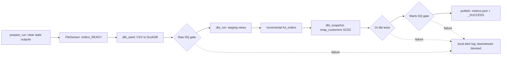

# dbt + Airflow, day 7: an end-to-end demo

A tiny, runnable **dbt + DuckDB + Airflow** project that ties the seven-day series together. Synthetic shop data flows from CSV seeds to typed staging views, an incremental order fact, SCD Type 2 customer history, tests, quality gates and local publication. No Docker or external services are required.

## Architecture



ASCII task order (staging and incremental models run inside `dbt_run`):

```text
prepare_run -> wait_for_orders_file -> dbt_seed -> dq_gate_raw
  -> dbt_run -> dbt_snapshot -> dbt_test -> dq_gate_marts -> publish
```

### Layers and tasks

| Layer / task | Responsibility |
|---|---|
| `prepare_run` | Removes previous readiness marker, metrics and per-run DQ reports; a failed run cannot appear published because of yesterday's marker. |
| `wait_for_orders_file` | FileSensor waits for `landing/orders_READY`; local runner simulates the upstream producer by creating it. |
| `dbt_seed` | Loads four CSV feeds: orders, customers, order updates and versioned customer profiles. |
| `dq_gate_raw` | Four SQL rules: nonempty orders, unique IDs, required fields, numeric amounts. Fail fast before transformations. |
| `dbt_run` | Builds four cleaned staging views plus incremental `fct_orders` using `delete+insert` keyed by `order_id`. Batch 2 updates 1007 and adds 1009/1010. |
| `dbt_snapshot` | Timestamp-strategy `snap_customers`: C002 moves from Abu Dhabi to Dubai, C003 changes gold to platinum, and C006 is added in batch 2. |
| `dbt_test` | 14 tests: uniqueness, nullability, accepted values, relationships and a custom amount-sign rule. |
| `dq_gate_marts` | Row-count range, positive net revenue, no duplicate current customer versions; pending share below 30% is warning-only. |
| `publish` | Writes actual counts/revenue to `published/metrics.json`, then `_SUCCESS` containing the successful Airflow run ID. This is local publication, not a remote upload. |

DAG ID: **`shop_analytics_e2e`**. Schedule `@daily`, catchup disabled, one active run. Normal tasks retry twice with exponential backoff starting at 10 seconds, capped at five minutes. DQ and dbt-test gates do not retry bad data. FileSensor uses reschedule mode and no retries. Execution and DAG-run timeouts replace obsolete Airflow SLA callbacks. Failure/retry callbacks are **local-only stubs** writing `alerts/alerts.log`; they send no messages or webhooks.

## Setup (Python 3.13)

Keep Airflow and dbt in separate environments. Versions below match the verified local run.

```bash
python3 -m venv .afvenv
.afvenv/bin/pip install 'apache-airflow==3.1.2' \
  --constraint https://raw.githubusercontent.com/apache/airflow/constraints-3.1.2/constraints-3.13.txt
python3 -m venv .dbtvenv
.dbtvenv/bin/pip install -r dbt/requirements.txt 'pyyaml==6.0.3'
```

The dbt requirements pin dbt-core 1.12.6, dbt-duckdb 1.11.1 and DuckDB 2.0.0. With shared environments already installed on this box, use symlinks instead of creating new environments:

```bash
ln -s /workspace/.afvenv .afvenv
ln -s /workspace/.dbtvenv .dbtvenv
```

Use either fresh environments or symlinks, not both. They are ignored by Git. `run_local.sh` creates the ignored `dbt/profiles.yml` from its example, configures a local SQLite Airflow metadata DB and `fs_default`, migrates metadata and executes `airflow dags test`; no scheduler/webserver is needed.

## One-command story

```bash
./demo.sh
```

**Sandbox reset:** this deletes this checkout's generated DuckDB file, dbt target/logs, Airflow metadata, reports and alerts. Do not point it at valuable warehouse data. It leaves source CSVs and environments alone. Run it serially; DuckDB is a single-writer local demonstration.

The script actually executes three Airflow DAG runs:

1. Clean batch 1: all gates pass and metrics are published.
2. Batch 2 on the same warehouse: incremental update/new orders and SCD2 history, all gates pass again.
3. Duplicate-order drill: raw gate fails, failure callback logs an alert, downstream tasks become `upstream_failed`, and no readiness marker survives.

`scripts/summary.py` queries DuckDB and Airflow's SQLite task states after each run, checks all 14 dbt test results on clean runs, validates counts/revenue/history totals, checks run-scoped alerts and publication, and saves JSON evidence. It does **not** assume a failed `airflow dags test` has a nonzero CLI exit code. Any unexpected state fails the demo.

```bash
.dbtvenv/bin/python3 scripts/summary.py all  # reprint saved evidence
# Full task output: logs/batch1.log, logs/batch2.log, logs/duplicate.log
# Evidence: published/demo/batch1.json, batch2.json, duplicate.json
```

### Individual runs and drills

```bash
./run_local.sh '{"batch": 1}'
./run_local.sh '{"batch": 2}'
./run_local.sh '{"batch": 2, "drill": "duplicate"}'
./run_local.sh '{"batch": 2, "drill": "bad_amount"}'
.dbtvenv/bin/python3 dq/check.py marts  # query the marts gate separately
```

Do batch 1 before batch 2 on a fresh warehouse. To replay from batch 1, use `./demo.sh` to reset it; this is not a historical rollback engine. A drill corrupts the seeded raw table deliberately; the next seed reloads it. The marts remain at the last good state when the raw gate blocks. Do not consume raw tables or assume old marts are fresh; check the current `_SUCCESS` marker.

To invoke Airflow directly after setup, with the same local environment:

```bash
export AIRFLOW_HOME="$PWD/airflow_home"
export AIRFLOW__CORE__DAGS_FOLDER="$PWD/dags"
export AIRFLOW__CORE__LOAD_EXAMPLES=False
export AIRFLOW__DATABASE__SQL_ALCHEMY_CONN="sqlite:///$AIRFLOW_HOME/airflow.db"
export AIRFLOW_CONN_FS_DEFAULT='{"conn_type": "fs", "extra": {"path": "/"}}'
export DBT_BIN="$PWD/.dbtvenv/bin/dbt" DQ_PYTHON="$PWD/.dbtvenv/bin/python3"
cp dbt/profiles.yml.example dbt/profiles.yml
mkdir -p landing && touch landing/orders_READY
.afvenv/bin/airflow db migrate
.afvenv/bin/airflow dags test shop_analytics_e2e "$(date -Iseconds)" -c '{"batch": 1}'
# Use a fresh timestamp for each subsequent run:
.afvenv/bin/airflow dags test shop_analytics_e2e "$(date -Iseconds)" -c '{"batch": 2}'
.afvenv/bin/airflow dags test shop_analytics_e2e "$(date -Iseconds)" -c '{"batch": 2, "drill": "duplicate"}'
```

For a real upstream sensor wait, do not create `orders_READY` until the producer is ready. The sensor timeout is one hour, but the DAG-run timeout is 30 minutes (and task execution timeout is ten minutes). Retry/backoff settings are configured; this demo proves the fail-fast data failure path, not recovery from an injected transient infrastructure outage.

## Verified output

| Run | DAG | Orders | Net revenue (AED) | Pending | Snapshot rows / current | Gates and publication |
|---|---|---:|---:|---:|---:|---|
| Batch 1 | success | 8 | 2201.00 | 12.5% | 3 / 3 | Raw 4/4, marts 4/4; 14 dbt tests pass; published |
| Batch 2 | success | 10 | 2464.75 | 10% | 6 / 4 | Raw 4/4, marts 4/4; 14 dbt tests pass; published |
| Duplicate drill | failed (expected) | 10 retained | 2464.75 retained | 10% | 6 / 4 retained | Raw: 1 error (`duplicate_ids=1`); marts not run; no publication |

Snapshot history shown by the final summary (source business timestamps, not commit dates):

```text
C002 | Abu Dhabi | bronze   | 2026-10-01 00:00:00 -> 2026-10-10 08:00:00
C002 | Dubai     | bronze   | 2026-10-10 08:00:00 -> current
C003 | Sharjah   | gold     | 2026-10-01 00:00:00 -> 2026-10-12 14:30:00
C003 | Sharjah   | platinum | 2026-10-12 14:30:00 -> current
```

The duplicate drill leaves 9 raw order rows, but 10 last-good fact rows. The local failure alert names `shop_analytics_e2e.dq_gate_raw`. No external alerts were sent.

## Boundaries

This is a teaching sandbox with synthetic data, not a production deployment. "Net revenue" here is the sum of all signed order amounts (including pending orders), not a revenue-recognition policy. The simple incremental global `updated_at` watermark assumes monotonically newer updates; production pipelines need late-arrival handling and broader reconciliation. Raw DQ checks cover `raw_orders`, not every possible defect in all feeds. SCD2 tracks profile timestamps and retains customers absent from the next feed; it is not hard-delete tracking. `_SUCCESS` is local readiness, not transactional warehouse isolation. Secrets and generated artifacts are ignored, and no Docker workflow is claimed.

## The week

1. [Skeleton](https://github.com/amitsehgal29/dbt-duckdb-day1-skeleton)
2. [Tests and docs](https://github.com/amitsehgal29/dbt-duckdb-day2-tests-docs)
3. [Incremental model and SCD2](https://github.com/amitsehgal29/dbt-duckdb-day3-incremental-snapshot)
4. [Airflow DAG](https://github.com/amitsehgal29/dbt-airflow-day4-dag)
5. [Sensors, retries and alerts](https://github.com/amitsehgal29/dbt-airflow-day5-sensors-retries-alerts)
6. [Data-quality gates](https://github.com/amitsehgal29/dbt-airflow-day6-dq-gates)
7. This end-to-end story, with assertions and run-scoped publication.
